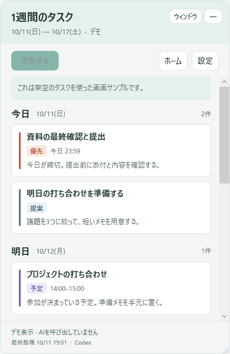

# Weekly Task Widget — 1週間のタスク

Windowsのデスクトップに、今日から7日間のタスクを埋め込んで表示する小さなアプリです。
Markdownのチェックボックスや締切表を読み、**「更新する」を押したときだけ**Codex CLIで一覧を整理します。
普段はローカルに保存した一覧を表示するため、AIを常時呼び出しません。



## できること

- 今日・明日・その後5日を1枚で表示。日付・曜日・締切・選んだ理由が分かります。
- AIが提案した着手日と、確定した予定・要確認事項を区別します。
- タスクの詳細とMarkdown内の根拠を開けます。
- 壁紙の上に表示し、他のアプリを使っているときはその後ろに隠れます。Windows+Dでデスクトップを表示しても残ります。
- ウィンドウ表示への切り替え、位置・サイズの保存、自動起動に対応します。
- ホームの変更や日付変更を表示します。再整理は手動です。
- 通信・認証・利用上限エラーでは、保存済みの一覧を保持します。

## 必要なものと費用

- Windows 11 x64（初版の確認環境）。配布ZIPには.NETランタイムを同梱します。
- [Codex CLI](https://learn.chatgpt.com/docs/cli)を導入し、**ChatGPTでログイン済み**であること。
- `ホーム.md`など、タスクの書かれたローカルMarkdown。

アプリ本体は無料です。有料ウィジェット・サーバー・APIキー契約は不要です。
AIによる更新は既存ChatGPTプランのCodex利用枠を消費します。契約中のプラン料金は別途かかります。
APIキー認証では更新せず、追加クレジット購入も行いません。アカウントに既存の追加クレジットがある場合の消費は、Codex側の利用条件に従います。
更新にはCLI標準モデルを使う独立したセッションを作り、既存のCodex設定を書き換えません。シェル・Web検索を無効にして、渡された抜粋だけを整理します。

## 使い方

1. [Releases](https://github.com/yuichiro-yokote/weekly-task-widget/releases)から`WeeklyTasks-win-x64.zip`を取得し、任意のローカルフォルダに展開します。
2. `Yokote.WeeklyTasks.exe`を起動します。
3. 「設定」で参照するMarkdownを選びます。OneDrive内の`2nd_brain/ホーム.md`が見つかる場合は初期候補になります。
4. 「更新する」を押します。最初の整理には数分かかることがあります。
5. 初期設定はデスクトップへの埋め込みです。上部の「デスクトップ」ボタン、または「設定」でウィンドウ表示へ切り替えられます。埋め込み表示では「隠す」ボタンを表示しません。終了は通知領域のメニューから行います。

ウィンドウ表示のときだけ「―」で隠せます。通知領域のアイコン、デスクトップのショートカット、実行ファイルの再起動で戻せます。

自動起動は初期設定で有効です。「設定」で解除できます。位置を見失ったときは「表示位置を右上へ戻す」を使います。

## タスクの入力と制約

通常のMarkdownチェックボックスを使います。完了した親タスクの下にある未完了の小項目は抽出しません。
「締切」「予定」「要対応メール」の見出し下にある表も参照します。チェック欄と文章の完了状態が食い違う場合はAIが慎重に整理します。

```markdown
## 今週やること
- [ ] 10/15までに資料を提出する
    - 10/13に下書きを確認する
- [x] 完了した申込

## 締切カレンダー
| 期限 | やること |
|---|---|
| 10/16 14:00 | 打ち合わせ |
```

AIの提案は確定した予定ではありません。日程・状態が不明なものは「確認したいこと」に表示されます。
日付が変わってもAIは自動起動しません。保存されていない日を「未整理」と表示するため、必要に応じて更新してください。
アプリから元のMarkdownへ追加・完了の書き込みは行いません。

## データの扱い

設定と表示用キャッシュは`%LOCALAPPDATA%\Yokote\WeeklyTasks`に保存します。アプリをOneDrive内に置いてもキャッシュはPC内です。
更新時にはタスクの抜粋をOpenAIのCodexへ送信します。URL・メールアドレス・一部の識別番号は省略し、`社外共有不可`・`社外秘`・`FUJITSU-RESTRICTED`等の明示があるセクションは除外します。
これは包括的な機密情報検出ではありません。送信してはいけない情報は、参照するMarkdownに含めないでください。
Claude Codeの設定・スキル・メモリは変更しません。認証情報はアプリで読んだりコピーしたりせず、Codex CLIに委ねます。

## ビルド・検証

[.NET 10 SDK](https://dotnet.microsoft.com/download/dotnet/10.0)を使います。追加のNuGetライブラリは使っていません。

```powershell
dotnet build WeeklyTasks.App/WeeklyTasks.App.csproj -c Release
dotnet run --project WeeklyTasks.Checks/WeeklyTasks.Checks.csproj -c Release
dotnet publish WeeklyTasks.App/WeeklyTasks.App.csproj -c Release -r win-x64 --self-contained true -o artifacts/win-x64
```

プレビューは架空のデータのみを使い、AI・実際のホーム・自動起動設定には触れません。

```powershell
./artifacts/win-x64/Yokote.WeeklyTasks.exe --demo
```

開発用のオプション:

- `--source <path>`: 参照Markdownを設定して起動。
- `--data-dir <path>`: 設定・キャッシュ保存先を指定。
- `--desktop` / `--window`: デスクトップへの埋め込み／ウィンドウ表示に切り替え。既存のプロセスがある場合も切り替えられます。
- `--refresh-only`: ウィンドウを出さずに1回更新し、成功なら終了コード0。自動起動設定は作りません。
- `--demo --export-preview <png>`: 架空の画面サンプルをPNGとして出力して終了。

初版は個人用の手動更新アプリです。Codex CLIの更新によって引数や認証条件が変わる場合があります。CLI 0.147.0で確認しています。

デスクトップ表示は、WPFの描画を保ったまま、デスクトップを所有者とするツールウィンドウをアプリの後ろに配置する方式です。v0.2.0で枠だけが表示される問題をv0.2.1で修正しました。Explorerの実装変更によって影響を受ける場合があります。設定からウィンドウ表示へ戻せます。Explorer再起動時は接続の回復を試みます。

## ライセンス

MIT License。CodexとChatGPTにはそれぞれの利用条件が適用されます。
